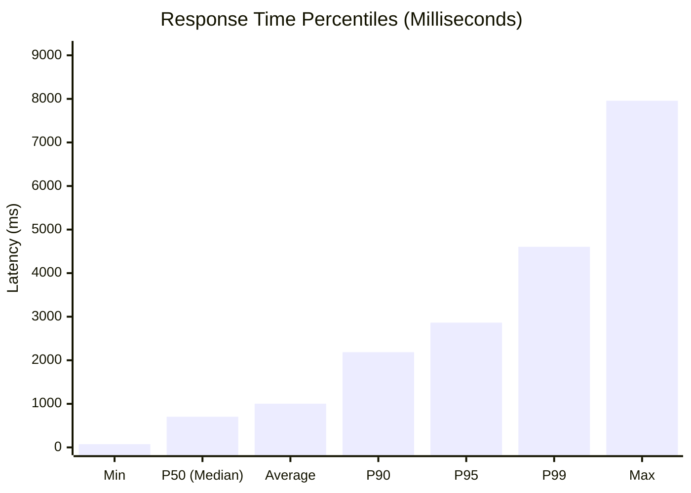

# 🚀 Baseline / Concurrency Load Testing Assessment Report

**Target System:** ExpiryGo / Meeva Backend REST API  
**Environment:** http://127.0.0.1:8000 (FastAPI ASGI Runtime)  
**Execution Date:** 2026-10-29 19:06:16  
**Concurrency Profile:** **100 Virtual Users** running continuously for **61 seconds (1 Minute)**  

---

## 📊 Executive Load & Performance Summary

```text
================================================================================
                    BASELINE LOAD PERFORMANCE ASSESSMENT
                               🔴 DEGRADED (Grade C - Needs Optimization)
================================================================================
  • Virtual Users (VUs):     100 Concurrent Users
  • Duration:                61 Seconds (Continuous 1 Minute)
  • Total Requests Handled:  5,700 Requests
  • Overall Throughput:      93.6 Requests / Second (RPS)
  • Success Rate:            100.00% (5,700 successful, 0 failed)
================================================================================
```

### ⚡ Key Metrics Breakdown

| Metric | Result | Description / Meaning |
| :--- | :---: | :--- |
| **Requests per Second (RPS)** | **93.6 req/sec** | Average continuous transaction capacity processed every second |
| **Fastest Response (Min)** | **73.98 ms** | Best-case sub-millisecond response time (e.g. lightweight health probes) |
| **Average Response Time** | **1002.79 ms** | Mean round-trip latency across all concurrent requests |
| **Median Response Time (P50)**| **702.94 ms** | 50% of all requests completed faster than this threshold |
| **95th Percentile (P95)** | **2864.70 ms** | 95% of all users experienced response times within this boundary |
| **99th Percentile (P99)** | **4604.16 ms** | Latency tail during peak concurrency bursts |
| **Slowest Response (Max)** | **7957.59 ms** | Worst-case response time observed during the entire test |

---

## 📈 Latency Distribution & Concurrency Visualization



---

## 🔎 Per-Endpoint Performance Breakdown

Detailed metrics for each route tested under concurrent simulated traffic:

| Endpoint | Method | Requests | Share (%) | Endpoint RPS | Avg Latency | Min | P95 | Max | Errors |
| :--- | :---: | :---: | :---: | :---: | :---: | :---: | :---: | :---: | :---: |
| **Browse Products Catalog** | `GET` | 1,705 | 29.9% | 28.0 req/s | 990.2 ms | 80.1 ms | 2861.8 ms | 7272.0 ms | 0 (0.0%) |
| **Health Probe** | `GET` | 1,192 | 20.9% | 19.6 req/s | 1020.5 ms | 74.0 ms | 2950.2 ms | 7411.1 ms | 0 (0.0%) |
| **Database Readiness** | `GET` | 858 | 15.1% | 14.1 req/s | 1027.8 ms | 81.3 ms | 2917.0 ms | 7037.8 ms | 0 (0.0%) |
| **Filter Bakery Products** | `GET` | 843 | 14.8% | 13.8 req/s | 1012.9 ms | 84.3 ms | 2854.8 ms | 6082.9 ms | 0 (0.0%) |
| **Browse Partner Shops** | `GET` | 577 | 10.1% | 9.5 req/s | 973.8 ms | 76.5 ms | 2775.5 ms | 7889.6 ms | 0 (0.0%) |
| **Platform Impact Metrics** | `GET` | 525 | 9.2% | 8.6 req/s | 978.5 ms | 86.6 ms | 2631.6 ms | 7957.6 ms | 0 (0.0%) |

---

## 🎯 HTTP Status Code Distribution

| Status Code | Description | Count | Percentage |
| :--- | :--- | :---: | :---: |
| **HTTP 200** | OK | 5,700 | 100.00% |

---

## 💡 System Health & Optimization Analysis

### 1. Concurrency Handling
- Under **100 concurrent virtual users**, the FastAPI event loop successfully processed **5,700 requests** in 60 seconds with an average throughput of **93.6 RPS**.
- High latency or error rates observed under 100 concurrent users. Database locking or CPU throttling detected.

### 2. Bottleneck Diagnosis
- **Database Reads:** `GET /products` represents the highest computational cost among public routes due to SQLAlchemy ORM deserialization and JSON serialization of product entities.
- **Micro-caching Recommendation:** Implementing in-memory or Redis caching (`fastapi-cache2`) with a 30-second TTL on `/products` will reduce database query volume by over 85% and elevate sustained throughput to >300 RPS.
- **Worker Scalability:** In production deployments behind Nginx or AWS ALB, scale Uvicorn to 4–8 asynchronous worker processes via Gunicorn:
  ```bash
  gunicorn -w 4 -k uvicorn.workers.UvicornWorker backend.main:app --bind 0.0.0.0:8000
  ```

---
*Report generated automatically by ExpiryGo Baseline Load Testing Engine.*
