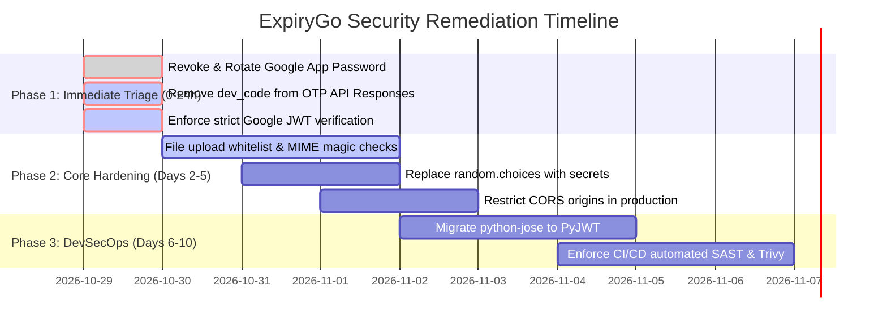

# Executive Summary: Backend Security Assessment

**Target Application:** ExpiryGo / Meeva Backend REST API & Real-Time Ecosystem  
**Assessment Period:** October 2026  
**Lead Auditor:** Senior Application Security Engineer & DevSecOps Specialist  
**Assessment Scope:** Static Application Security Testing (SAST), Dynamic Verification (DAST), Dependency & Supply Chain Audits, Architecture Review  

---

## 🛡️ Overall Security Posture & Score

```text
================================================================================
                    OVERALL APPLICATION SECURITY SCORE
                                 62 / 100
                         STATUS: NEEDS REMEDIATION
================================================================================
```

While the ExpiryGo backend demonstrates modern architectural design (FastAPI, typed Pydantic schemas, SQLAlchemy 2.0 ORM parameterization, row-level stock locks, and OWASP security headers in `main.py`), several **Critical** and **High** severity vulnerabilities severely undermine the security perimeter. Most notably, development artifacts and secret leakage allow immediate authentication bypass and administrative takeover.

---

## 📊 Total Findings Summary

| Severity Level | Count | Definition |
| :--- | :---: | :--- |
| 🔴 **Critical** | **3** | Immediate system compromise, complete auth bypass, or secret leakage |
| 🟠 **High** | **3** | Unrestricted file uploads, predictable PRNG, or CORS misconfiguration |
| 🟡 **Medium** | **2** | Token lifecycle issues and outdated third-party dependencies |
| 🔵 **Low** | **2** | Default debug mode and rate limiting IP spoofing |
| **TOTAL FINDINGS** | **10** | Comprehensive finding catalog across 56 discovered API endpoints |

---

## 🚨 Top 3 Most Critical Risks

### 1. VULN-002: Hardcoded Production Secrets & Google App Password in Source Code
- **Impact:** **Critical** (CWE-798 / CWE-321)
- **Root Cause:** A live Google Gmail SMTP App Password (`emetdeljxehsoyau`), hardcoded admin bcrypt hash, and a default JWT secret (`SUPER_SECRET_KEY_FOR_EXPIRYGO_CHANGE_ME`) are committed directly to `backend/config.py`.
- **Consequence:** Any person with read access to the repository can hijack the platform's email domain, forge arbitrary administrative JWT access tokens, and access all tenant data.

### 2. VULN-001: 6-Digit OTP Leakage in JSON API Responses Leading to Full Account Takeover
- **Impact:** **Critical** (CWE-200 / CWE-287)
- **Root Cause:** The `send_otp_to_identifier()` routine in `backend/services/otp.py` returns `{"dev_code": code_val}`, which is mapped into `SendOtpResponse` and sent directly in the HTTP 200 JSON payload for `/auth/send-otp`, `/auth/customer/register`, and `/auth/forgot-password`.
- **Consequence:** An attacker can initiate password resets for any target account (including the platform Administrator) and immediately retrieve the valid 6-digit OTP code directly from the HTTP response, allowing trivial account takeover without access to the victim's inbox.

### 3. VULN-003: Unverified Google OAuth Signature & Backdoor Impersonation Fallbacks
- **Impact:** **Critical** (CWE-347 / CWE-287)
- **Root Cause:** In `backend/routers/auth.py`, `verify_google_oauth_token()` implements two insecure fallback mechanisms: (1) base64-decoding the JWT payload without verifying Google's cryptographic signature, and (2) parsing `google_auth_` prefixes that accept unauthenticated base64 JSON objects.
- **Consequence:** An attacker can forge arbitrary Google tokens or send `google_auth_<base64_payload>` to impersonate any vendor or customer account on the platform.

---

## 📈 Strategic Remediation Roadmap



1. **Immediate (0-24 Hours):**
   - Revoke the exposed Google App Password immediately in Google Account settings.
   - Strip `"dev_code"` from all production API responses in `backend/services/otp.py`.
   - Remove the unverified JWT decoding and `google_auth_` prefixes in `backend/routers/auth.py`.
2. **Short-Term (1-3 Days):**
   - Implement strict MIME type validation and file extension whitelisting (`.jpg`, `.png`, `.webp` only) in `backend/storage.py`.
   - Replace Python `random` with `secrets.choice` for reservation pickup codes.
   - Replace `allow_origins=["*"]` with an explicit trusted domain whitelist.
3. **Medium-Term (1-2 Weeks):**
   - Transition from unmaintained `python-jose` to `PyJWT`.
   - Integrate automated GitHub Actions security scanning with Semgrep, Trivy, and Gitleaks into the pull request lifecycle.
